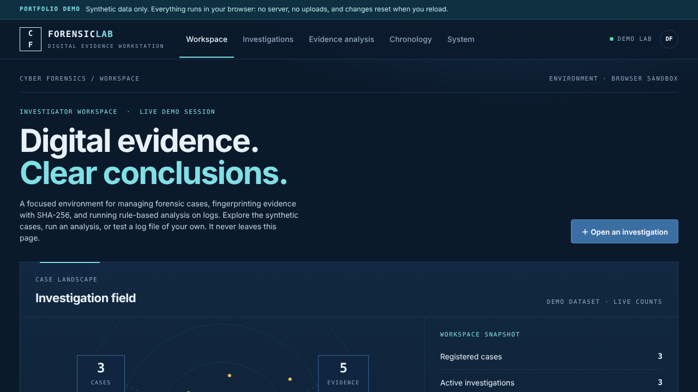

# ForensicLab · Digital Evidence Workstation

A local-first case and evidence management application for digital forensics, built with **Python, Flask and SQLite**.



**Live demo (browser-only, synthetic data):** https://tahani-forensiclab.netlify.app

## The problem
Small IT and security teams often track investigations in spreadsheets and shared folders. Evidence gets copied without a record of its integrity, log files are reviewed by hand, and it is hard to show what happened, in what order, and who did what.

## What it does
- **Case management**: register investigations with priority, status, investigator and an activity log for each case.
- **Evidence integrity**: every uploaded file is fingerprinted with **SHA-256** on acquisition and stored under a randomised name. The stored copy is never modified.
- **Rule-based log analysis**: text and log files are scanned line by line for indicators such as credential dumping (`lsass`, `procdump`, `comsvcs.dll`), encoded PowerShell, scheduled-task persistence, privilege changes, failed logins, port scans and encoded content.
- **Findings & chronology**: matches become findings with a severity, and a timeline orders them by the timestamp in the source line.
- **PDF investigation report** for each case (ReportLab).
- **JSON ingestion API** (`POST /api/ingest`) with optional bearer-token protection.

## Security decisions
- Files are **never executed**; only readable text formats are analysed.
- Upload size limit (20 MB), extension allow-list and randomised stored names.
- Secret key and API token come from **environment variables**, never from the code.
- `debug=False`, HTTP-only and SameSite session cookies.
- Demo data is **synthetic** (documentation IP ranges, invented hosts and users).

## Run locally
```bash
python -m venv .venv
# Windows
.venv\Scripts\activate
# macOS / Linux
source .venv/bin/activate

pip install -r requirements.txt
python app.py
```
Open http://127.0.0.1:5000 and upload `sample_evidence.log` to a case to see the analysis.

Optional environment variables:

| Variable | Purpose |
|---|---|
| `CFL_SECRET_KEY` | Flask session secret (random if not set) |
| `CFL_API_TOKEN` | Requires `Authorization: Bearer <token>` on `/api/ingest` |

## API example
```bash
curl -X POST http://127.0.0.1:5000/api/ingest \
  -H "Content-Type: application/json" \
  -d '{"case_ref":"CFL-DEMO-001","message":"Failed password for demo_user from 192.0.2.10"}'
```

## Scope note
This is a learning and portfolio project. It is designed to run locally and is not hardened for public internet deployment (there is no user authentication). Findings are indicators for human review, not proof of malicious activity.

## Project structure
```
app.py               Flask app, database, analysis rules, PDF reports, API
templates/           Jinja2 pages
static/style.css     UI styles
sample_evidence.log  Synthetic log for testing the rules
```

---
Built by **Tahani Alqarni** · Management Information Systems, King Khalid University
